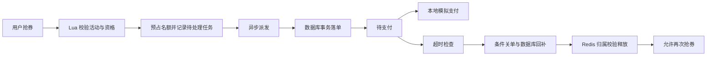
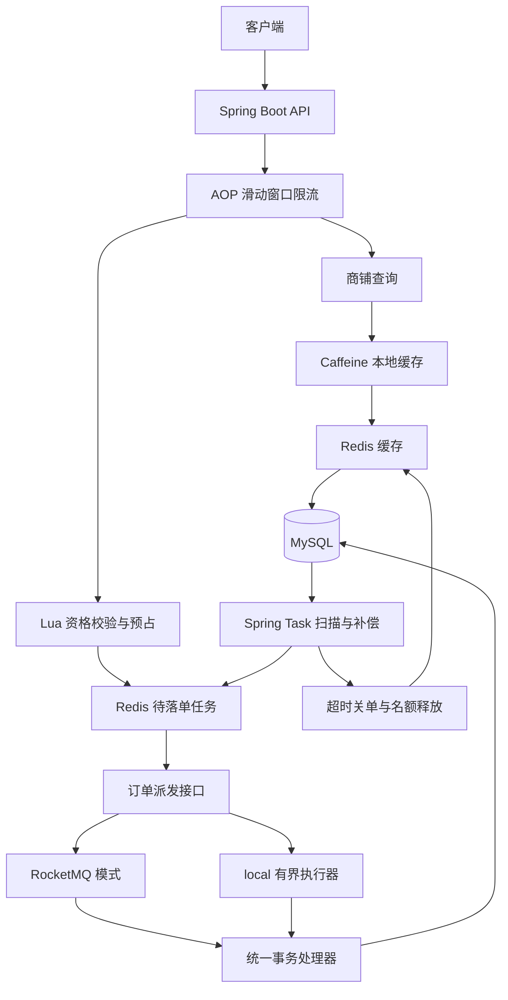

<h1 align="center">CitySeek</h1>

<p align="center">
  <a href="https://github.com/SupexVoid/CitySeek/stargazers"></a>
  
  
  
  
  
  
  <a href="LICENSE"></a>
</p>

<p align="center">
  <a href="#业务流程">业务流程</a> ·
  <a href="#系统架构">系统架构</a> ·
  <a href="#核心技术与实现亮点">技术亮点</a> ·
  <a href="#快速运行">快速运行</a> ·
  <a href="docs/local-verification.md">验证记录</a>
</p>

**一个围绕热点商铺查询与优惠券秒杀设计的本地生活平台。**

支持商铺浏览、优惠券抢购、异步落单与订单状态查询，重点解决高频读取、并发预占和超时库存释放问题。通过二级缓存、Lua 原子预占、条件更新与补偿任务，将“查得快、抢得准、失败能恢复”连接成完整业务链路。

## 业务流程

抢到名额和订单落库是两个阶段：接口先返回预占订单号，用户随后查询订单处理结果。



本地冒烟已检查冷缓存查询、更新失效、异步落单、重复抢购拒绝、超时关单、名额释放、重新抢购及模拟支付竞争。详细证据见[验证记录](docs/local-verification.md)。本仓库以 API 与后端链路为主，未提供前端界面截图。

## 系统架构



两种消息模式共用事务处理器：`local` 便于在没有 Broker 时验证业务；`rocketmq` 使用消息队列及延迟检查。MySQL 保存订单和恢复状态，Redis 承担缓存、原子预占与待落单记录。

**[查看详细设计与一致性处理 →](docs/architecture.md)**

## 核心技术与实现亮点

### 1. Caffeine + Redis：为热点查询构建二级缓存

商铺详情具有高频读取、低频修改的特点，重复请求不必每次访问数据库或远端缓存。

- **分层读取：** Caffeine → Redis → MySQL，本地缓存限制 1000 条，写入后 5 秒过期。
- **击穿与穿透：** 缺失时互斥回源，空结果短期缓存；逻辑过期返回旧值并异步刷新，降低热点集中回源。
- **并发回填保护：** 本地失效递增版本，并协调失效与回填，防止较早的查询将旧值写回缓存。

本地缓存仅保存展示信息，实时库存与秒杀资格不进入 L1；物理 TTL 回收长期未刷新的副本。

### 2. 事务内失效任务：让缓存更新失败也有补偿路径

更新数据库后直接删缓存，可能在提交失败、Redis 故障或进程退出时留下不一致数据。

- **同事务记录：** 商铺更新与失效任务一并写入 MySQL，事务提交后才尝试失效缓存。
- **失败保留：** Redis 删除失败时保留任务，可通过 RocketMQ 通知或定时扫描继续处理。
- **任务令牌：** 清理恢复记录时校验令牌，避免旧处理删除后来生成的新失效任务。

该链路实现最终一致，不将短期本地展示缓存描述为强一致缓存。

### 3. Redis + Lua：将资格校验与预占做成原子操作

秒杀请求需要同时检查活动时间、库存与重复购买，应用层多次读写容易出现并发窗口。

- **一次校验：** Lua 在 Redis 中校验活动、用户资格和可用名额，再完成预扣。
- **原子记录：** 同一脚本保存用户与订单号的预占归属、待落单任务，缩小预占成功后进程退出造成的恢复缺口。
- **稳定订单号：** 重试沿用原订单号，便于后续识别重复处理、查询落单结果及释放对应名额。

### 4. 异步落单与幂等：将流量入口和事务写库解耦

抢券请求先获得预占结果，再由后台创建订单，避免把数据库事务放在请求主链路中长时间等待。

- **统一处理：** RocketMQ 与本地有界执行器共用 `OrderTaskProcessor` 和订单事务逻辑。
- **重复保护：** 基于订单号防重，结合数据库条件扣库存；失败事务回滚，不重复创建相同订单。
- **恢复重试：** 事务落单完成后移除 Redis 待办，投递失败或处理未完成时可沿用原任务重试。

返回订单号表示已受理，不等同于数据库订单已立即可见。

### 5. 延迟检查 + 定时兜底：完成超时关单与库存释放

未支付订单长期占用库存，会影响后续用户；关单、支付和名额释放还可能同时发生。

- **双路检查：** RocketMQ 延迟消息触发检查，Spring Task 扫描兜底；每次以实际截止时间判断是否关单。
- **条件变更：** 只有未支付且到期的订单可取消，关单与数据库库存回补在同一事务完成。
- **归属释放：** Redis Lua 校验用户当前占用的订单号，旧订单重复释放不会释放新订单名额。
- **失败可追踪：** Redis 释放失败保留数据库待释放标记，再由后台重试；晚到支付仅记录幂等退款待办。

支付为本地模拟，退款待办不连接真实资金渠道；默认付款期 15 分钟、扫描周期 1 分钟，不承诺精确定时。

### 6. 注解 + AOP + Lua：统一接口滑动窗口限流

通过注解声明限流策略，AOP 统一执行 Redis ZSet 滑动窗口统计，减少业务接口内的重复控制代码。

- **多维入口：** 支持 global、IP 和用户维度。
- **原子判断：** Lua 清除窗口外请求、判断阈值并记录新请求。
- **独立计数：** 使用唯一请求 ID 作为成员，避免同毫秒请求相互覆盖导致低估请求量。

## 技术栈与源码入口

| 模块 | 技术 | 代码入口 |
| --- | --- | --- |
| API 与持久化 | Spring Boot 2.3.12、MyBatis-Plus、MySQL 8 | `src/main/java/com/hmdp/controller/`、`mapper/` |
| 缓存与一致性 | Caffeine 2.9.3、Redis、Redisson | `utils/CacheClient.java`、`cache/` |
| 原子预占与释放 | Redis、Lua | `src/main/resources/seckill.lua`、`release_reservation.lua` |
| 异步订单与恢复 | RocketMQ、Spring Task、有界执行器 | `src/main/java/com/hmdp/order/` |
| 请求控制 | 注解、AOP、ZSet、Lua | `aspect/RateLimitAspect.java`、`annotation/RateLimiter.java`、`sliding_window.lua` |

源码目标 Java 8，已有构建验证使用 JDK 17；徽章不代表已升级至 Spring Boot 3 或 JDK 21。

## 快速运行

准备 JDK 8 或 17、Maven、MySQL 8、Redis 5+。默认本地地址 `127.0.0.1:8081`，local 配置使用 Redis DB 12。

```powershell
# 专用演示库初始化；脚本拒绝覆盖已有库
$env:MYSQL_PASSWORD = '你的本机 MySQL 密码'
./scripts/init-local.ps1 -Database cityseek_local
./scripts/run-local.ps1
```

默认 local 模式不需要 RocketMQ Broker；使用消息队列时按[运行指南](docs/running.md)准备 Topic 并切换 `rocketmq` profile。

## 测试与验证

```powershell
# 启动隔离 Redis、执行事务与并发回归，结束后关闭该测试实例
./scripts/test.ps1
```

2026-10-19 的本地记录为 **20 项自动化测试通过**，使用真实 Redis 与 H2 事务测试，另以独立 MySQL 做接口冒烟。覆盖缓存回填竞争、失效补偿、并发预占、重复消息、支付关单竞争、重复释放与窗口计数；不是 QPS 或延迟压测结果。

[完整验证记录](docs/local-verification.md) · [本地运行与接口说明](docs/running.md)

当前面向本地单实例；真实 RocketMQ Broker 投递与故障行为尚未完成集成验收。Redis 待办依赖其数据保留，不承诺 Redis 数据丢失后的全量恢复；本项目不含真实支付、退款渠道或集群缓存广播。

## 仓库结构

```text
CitySeek/
├── src/main/java/com/hmdp/  # API、缓存、订单与限流
├── src/main/resources/     # 配置、Lua、Mapper 与 SQL
├── src/test/               # 回归测试
├── scripts/                # 初始化、启动、测试与接口冒烟
├── docs/                   # 架构、运行和验证记录
├── pom.xml                 # 依赖与构建配置
└── LICENSE
```

## 致谢与许可

使用 [MIT License](LICENSE)，保留版权声明。
